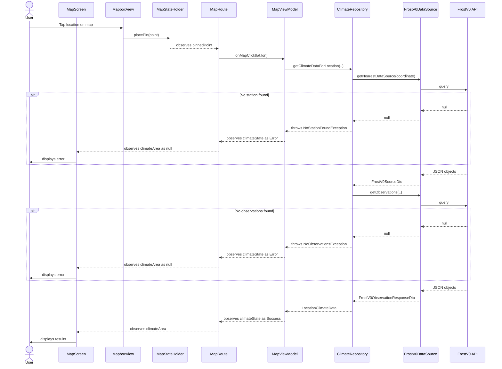

# Modeling

## Table of Contents

- [Modeling](#modeling)
  - [Table of Contents](#table-of-contents)
  - [Use Case Diagrams](#use-case-diagrams)
  - [Sequence Diagrams](#sequence-diagrams)
  - [Class Diagrams](#class-diagrams)
  - [Activity \& State Diagrams](#activity--state-diagrams)

---

## Use Case Diagrams

> Document the use case diagrams here, illustrating the interactions between actors and the system.

---

## Sequence Diagrams

> Document the sequence diagrams here, showing how objects and components interact over time for key flows.

---

## Class Diagrams

> Document the class diagrams here, depicting the structure of the codebase including classes, attributes, methods, and relationships.

---

## Activity & State Diagrams

> Document the activity and/or state diagrams here, capturing the flow of control and state transitions within the app.