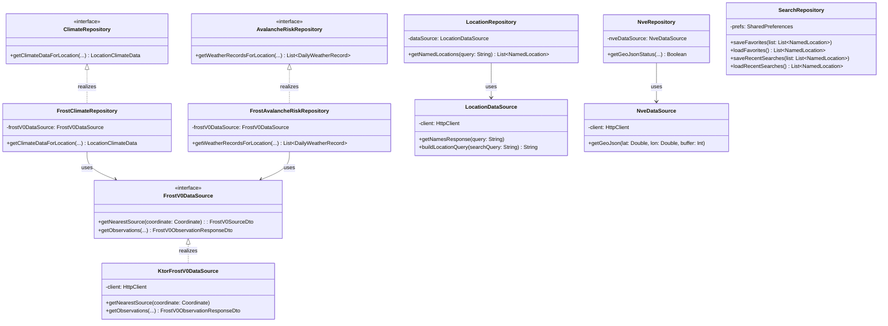

# Modeling

## Table of Contents

1. [Use Case Diagrams](#1-use-case-diagrams)
2. [Sequence Diagrams](#2-sequence-diagrams)
3. [Class Diagrams](#3-class-diagrams)
4. [Activity & State Diagrams](#4-activity--state-diagrams)

---

## 1. Use Case Diagrams

> Document the use case diagrams here, illustrating the interactions between actors and the system.

---

## 2. Sequence Diagrams

> Document the sequence diagrams here, showing how objects and components interact over time for key flows.

---

## 3. Class Diagram

> Document the class diagrams here, depicting the structure of the codebase including classes, attributes, methods, and relationships.

Class diagram of the data layer, depicting the following:
1. DataSources used to query Frost v0, NVE SnøskredAktsomhet and Kartverket Stedsnavn. 
2. Repositories responsible for transforming the data from the DataSources into domain objects used by the UI and domain layers, as well as managing preferences stored locally.
3. The interfaces which the DataSources and Repositories have implemented (where applicable.)

---

## 4. Activity & State Diagrams

> Document the activity and/or state diagrams here, capturing the flow of control and state transitions within the app.