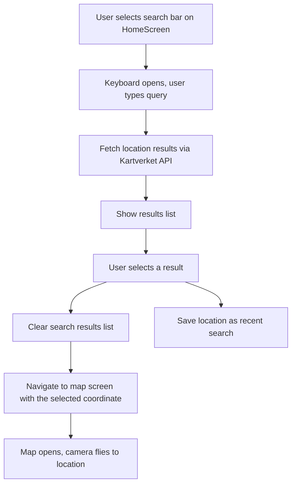
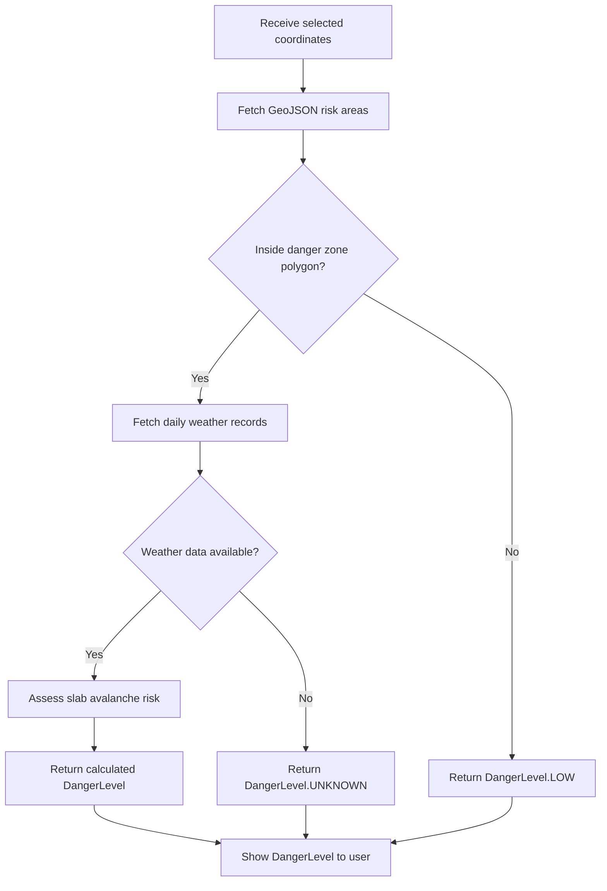
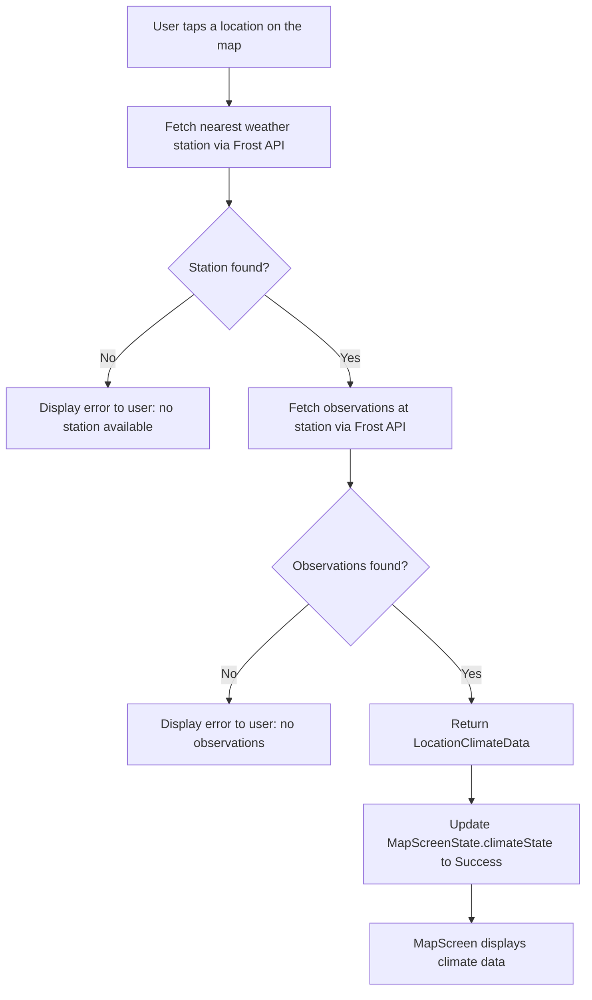

# Modeling

## Table of Contents

1. [Use Case Diagrams](#1-use-case-diagrams)
2. [Sequence Diagrams](#2-sequence-diagrams)
3. [Class Diagrams](#3-class-diagrams)
4. [Activity & State Diagrams](#4-activity--state-diagrams)

---

## 1. Use Case Diagrams

> Document the use case diagrams here, illustrating the interactions between actors and the system.

---

## 2. Sequence Diagrams

> Document the sequence diagrams here, showing how objects and components interact over time for key flows.

---

## 3. Class Diagrams

> Document the class diagrams here, depicting the structure of the codebase including classes, attributes, methods, and relationships.

---

## 4. Activity & State Diagrams

> Document the activity and/or state diagrams here, capturing the flow of control and state transitions within the app.

### Risk assessment

> This reflects the second part of Use Case #1, after a location has been selected and the map has been opened.

### Historical climate data

> This reflects Use Case #2. The user starts from the map screen and taps the map to see an overview of historical climate data.

