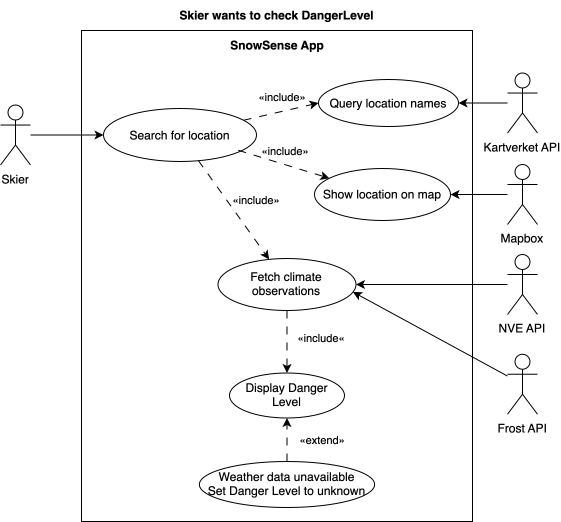
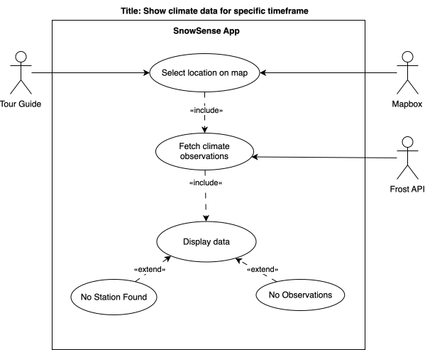
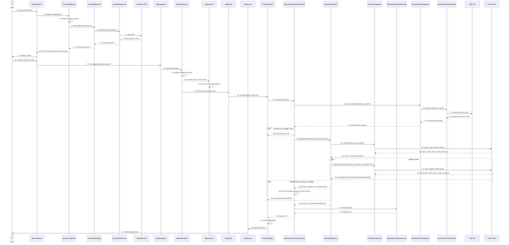
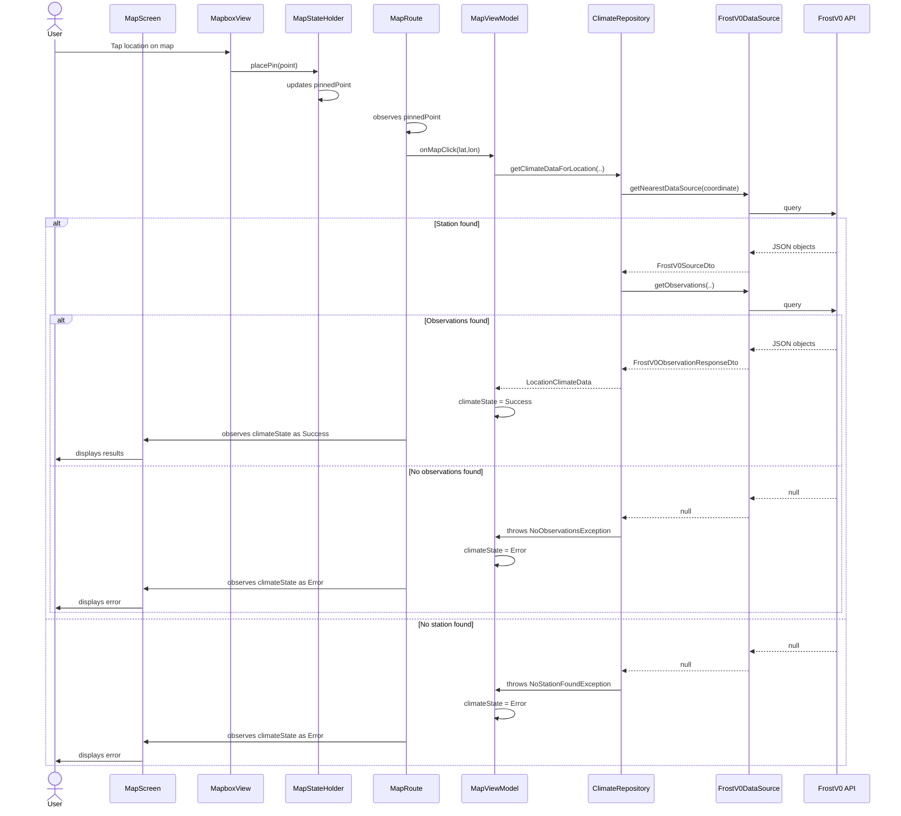
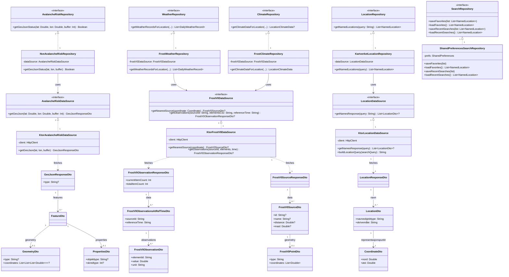
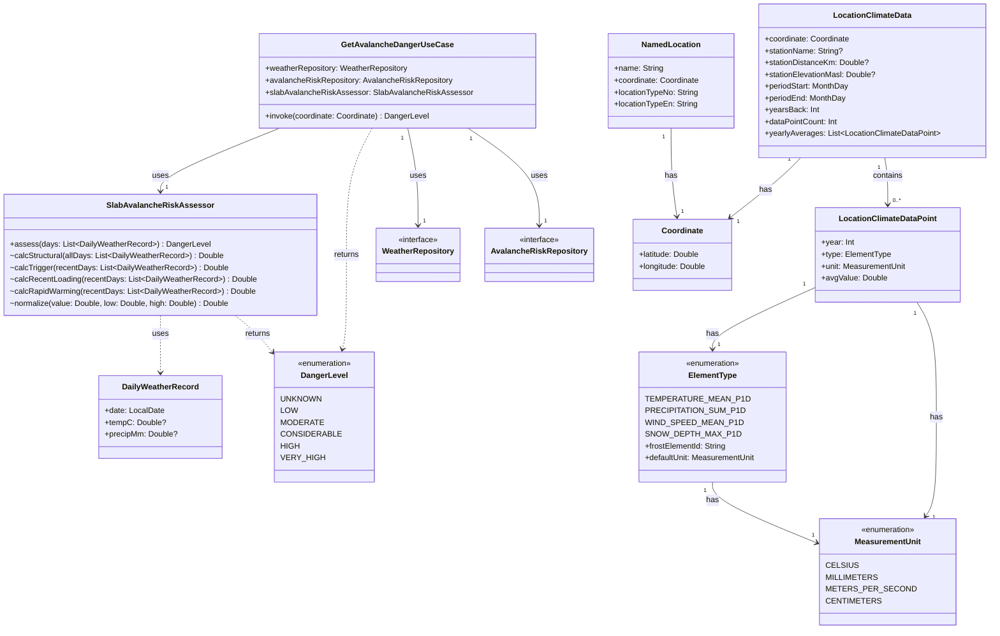
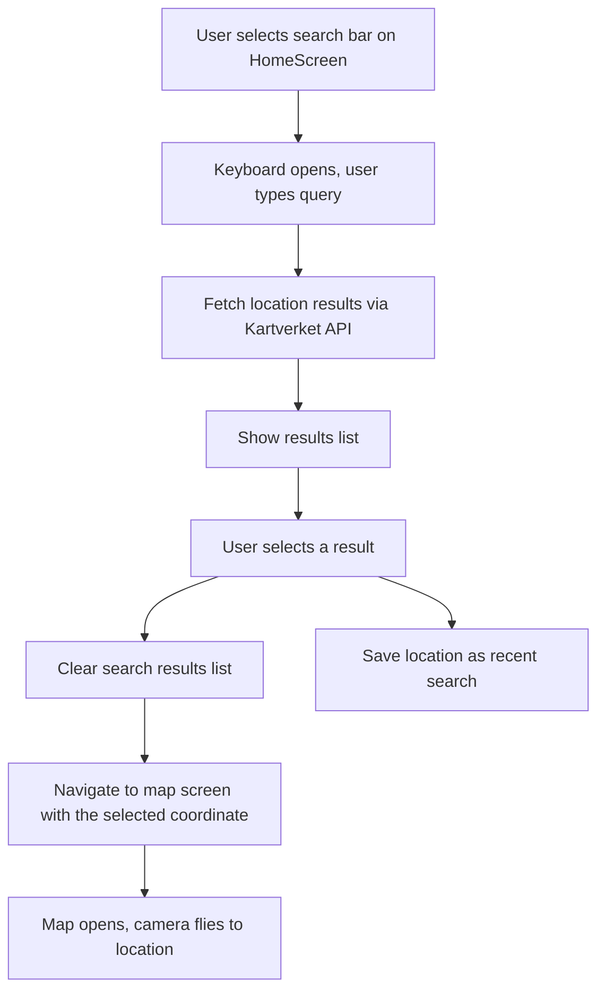
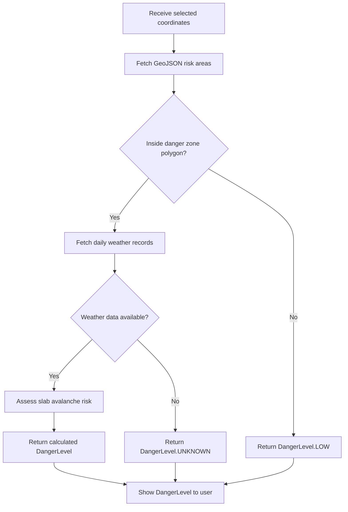
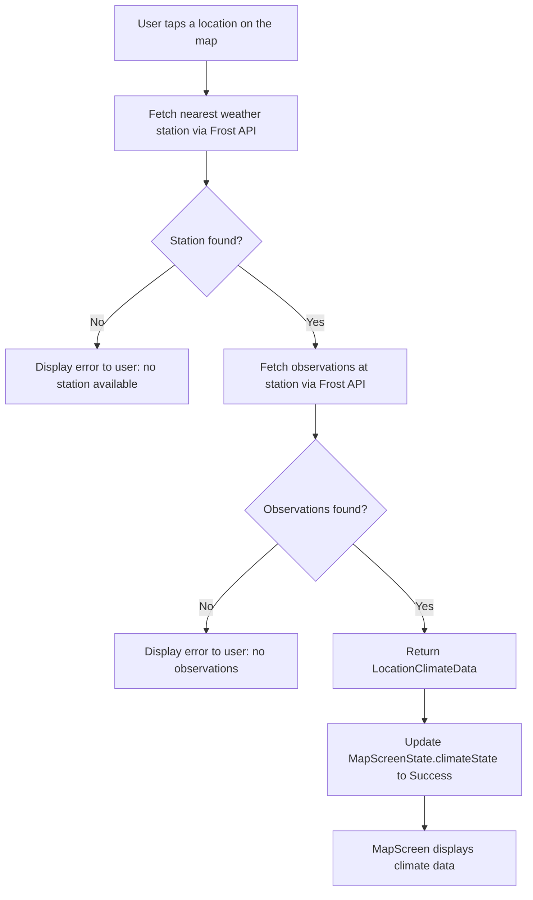

# Modeling

## Table of Contents

- [Modeling](#modeling)
  - [Table of Contents](#table-of-contents)
  - [Use Case Diagrams](#use-case-diagrams)
  - [Sequence Diagrams](#sequence-diagrams)
  - [Class Diagrams](#class-diagrams)
  - [Activity \& State Diagrams](#activity--state-diagrams)

---

## Use Cases

### Use Case #1

#### Description

**Name:** User wants to check Danger Level for a location \
**Primary Actor:** App user (skier) \
**Secondary Actor:** NVE API, Frost API, Mapbox, Kartverket API \
**Precondition:** User starts from search bar on HomeScreen \
**Postcondition:** The user can see the calculated danger level for the chosen location, or sees dangerlevel unknown. 

#### Main Flow:

1. User starts typing location into the search bar
2. `SearchSection` calls `onQueryChange(query)`
3. `SearchViewModel` watches for query changes, debounces them, and waits for the input to settle before searching
4. `SearchViewModel` calls `LocationRepository.getNamedLocations(query)`, i.e. sends the query to LocationRepository 
5. `LocationRepository` calls `LocationDataSource.getNamesResponse(query)`, i.e. sends the query to `LocationDataSource`. 
6. `LocationsDataSource` queries Kartverket API
7. `Kartverket` returns raw JSON response to `LocationDataSource`
8. `LocationDataSource` deserializes the response into a `List<LocationDto>`
9. `LocationRepository` transforms location DTOs to a `List<NamedLocations>`
10. `SearchViewModel` updates the search results in the `SearchUiState`
11. `SearchSection` displays the results to user (as a dropdown list)
12. User selects a location from the list 
13. `SearchSection` triggers navigation to the map with the selected coordinate by calling `onNavigateToMap(coordinate)`
14. `AppNavigation` converts the coordinate to a Mapbox `Point` and calls `flyToSearch(Point)`, which tells the `MapStateHolder` to “fly” there. 
15. `MapStateHolder` updates the pinned point on the map
16. `MapStateHolder` sends the selected point with a camera-move command (FlyTo) to MapboxView
17. `MapboxView` moves the camera and displays the pin on the map
18. `MapRoute` observes the selected point
19. `MapRoute` calls `RiskViewModel.updateDangerLevel(lat, lon)`, telling `RiskViewModel` to calculate the danger level for the coordinate
20. `RiskViewModel` invokes `GetAvalancheDangerUseCase` with the coordinate
21. `GetAvalancheDangerUseCase` calls `AvalancheRiskRepository.getGeoJsonStatus(lat, lon, buffer)`, to check if whether the location is in a danger zone 
22. `AvalancheRiskRepository` calls `AvalancheRiskDataSource.getGeoJson(lat, lon, buffer)`
23. `AvalancheRiskDataSource` queries NVE API.
24. NVE API returns GeoJSON/JSON response.
25. `AvalancheRiskDataSource` deserializes the response to a `GeoJsonResponseDto`, and returns this to `AvalancheRiskRepository`
26. `AvalancheRiskRepository` returns true/false, depending on whether the response was empty or not, to `GetAvalancheDangerUseCase`.
27. If the location is within a danger zone, then  `GetAvalancheDangerUseCase` calls `WeatherRepository.getWeatherRecordsForLocation(coordinate)`, asking the `WeatherRepository` for weather records at that location
28. `WeatherRepository` calls `FrostV0DataSource.getNearestSource(coordinate)`, i.e. asking it to fetch the nearest weather station 
29. `FrostV0DataSource` queries Frost API 
30. Frost API returns station data as JSON, an error or empty response
31. `FrostV0DataSource` returns `FrostV0SourceDto` or `null` to `WeatherRepository`.
32. If a station is found, `WeatherRepository` calls `FrostV0DataSource.getObservations(…)`.
33. `FrostV0DataSource` queries Frost API for weather observations
34. Frost API returns observation data as JSON, an error or empty response
35. `FrostV0DataSource` returns `FrostV0ObservationResponseDto` or `null` to WeatherRepository
36. WeatherRepository transforms the observations into DailyWeatherRecords and returns `List<DailyWeatherRecord>` to `GetAvalancheDangerUseCase`
37. `GetAvalancheDangerUseCase` calls `SlabAvalancheRiskAssessor.assess(records)`, i.e. passing the records to `SlabAvalancheRiskAssessor` for evaluation
38. `SlabAvalancheRiskAssessor` returns a `DangerLevel` to `GetAvalancheDangerUseCase`.
39. `GetAvalancheDangerUseCase` returns that `DangerLevel` to `RiskViewModel`
40. `RiskViewModel` updates `RiskUiState`
41. `MapScreen` observes `RiskUiState`
42. `MapScreen` displays `DangerLevel` to the user

#### Alternative Flow for Step 26 **Location is not in an avalanche danger zone**

26.1. `GetAvalancheDangerUseCase` returns `DangerLevel.LOW` to `RiskViewModel`. \
26.2. Continue from step 40. \

#### Alternative Flow for Step 35: **Weather data is unavailable**

35.1. `WeatherRepository` throws an exception to `GetAvalancheDangerUseCase` due to missing or unusable weather records \
35.2. `GetAvalancheDangerUseCase` catches the exception and treats the records as empty \
35.3. `GetAvalancheDangerUseCase` returns `DangerLevel.UNKNOWN` to `RiskViewModel` \
35.4. continue from step 40

### Use Case #2

#### Description

**Name:** Tour guide wants to view historical climate data for a manually selected location \
**Primary Actor:** App user (Ski Tour Guide) \
**Secondary Actor:** Mapbox, Frost V0 API \
**Precondition:** User starts on MapScreen \
**Postcondition:** Historical climate data is displayed to the user, or an error message is shown if no station or observations were found.

#### Main Flow:

1. User manually taps a location on the map
2. `MapboxView` calls `mapStateHolder.placePin(point)`
3. `MapStateHolder` updates `pinnedPoint`
4. `MapRoute` observes `pinnedPoint`
5. `MapRoute` calls `mapViewModel.onMapClick(lat, lon)`
6. `MapViewModel` calls `climateRepository.getClimateDataForLocation(..)`
7. `ClimateRepository` calls `frostV0DataSource.getNearestSource(coordinate)`
8. `FrostV0DataSource` queries Frost API
9.  Frost API returns JSON objects to `FrostV0DataSource`
10. `FrostV0DataSource` returns `FrostV0SourceDto` to `ClimateRepository`
11. `ClimateRepository` calls `frostV0DataSource.getObservations(..)`
12. `FrostV0DataSource` queries Frost API
13. Frost API returns JSON objects to `FrostV0DataSource`
14. `FrostV0DataSource` returns `FrostV0ObservationResponse` to `ClimateRepository`
15. `ClimateRepository` returns `LocationClimateData` to `MapViewModel`
16. `MapViewModel` updates `MapScreenState.climateState` to `ClimateState.Success`
17. `MapScreen` observes `MapScreenState.climateState`
18. `MapScreen` displays results to the user

#### Alternative Flow for Step 8:

8.1 Frost API returns `null` to `FrostV0DataSource` \
8.2 `FrostV0DataSource` returns `null` to `ClimateRepository` \
8.3 `ClimateRepository` throws `NoStationFoundException(coordinate)` \
8.4 `MapViewModel` catches `NoStationFoundException(coordinate)` from `ClimateRepository` \
8.5 `MapViewModel` updates `MapScreenState.climateState` to `ClimateState.Error` \
8.6 `MapScreen` observes `MapScreenState.climateState` \
8.7 Return to main flow point 17.

#### Alternative Flow for Step 12:

12.1 Frost API returns `null` to `FrostV0DataSource` \
12.2 `FrostV0DataSource` returns `null` to `ClimateRepository` \
12.3 `ClimateRepository` throws `NoObservationsException(..)` \
12.4 `MapViewModel` catches `NoObservationsException(..)` from `ClimateRepository` \
12.5 `MapViewModel` updates `MapScreenState.climateState` to `ClimateState.Error` \
12.6 `MapScreen` observes `MapScreenState.climateState` \
12.7 Return to main flow point 17.

## Use Case Diagrams

### Use case #1

### Use case #2

---

## Sequence Diagrams

> Sequence diagram representing Use Case #1

> Sequence diagram representing Use Case #2

---

## Class Diagrams

Class diagram representing the relevant data layer classes:
1. DataSources used to query Frost v0, NVE SnøskredAktsomhet and Kartverket Stedsnavn. 
2. Repositories responsible for transforming the data from the DataSources and returning domain objects used by the UI and domain layers, as well as managing preferences stored locally.
3. The interfaces which the DataSources and Repositories have implemented (where applicable.)
4. DTOs returned by DataSources to Repositories

Class diagram representing the relevant domain layer classes:
1. Use case for getting a danger level.
2. Slab avalanche risk assessor, a business logic class which calculates estimated risk based on weather records returned by an AvalancheRiskRepository.
3. Domain models used by both the UI layer and business logic on the domain layer.

Repository interfaces have been omitted.

---

## Activity & State Diagrams

> This reflects the first part of Use Case #1, where the user searches for a location.

### Risk assessment

> This reflects the second part of Use Case #1, after a location has been selected and the map has been opened.

### Historical climate data

> This reflects Use Case #2. The user starts from the map screen and taps the map to see an overview of historical climate data.

